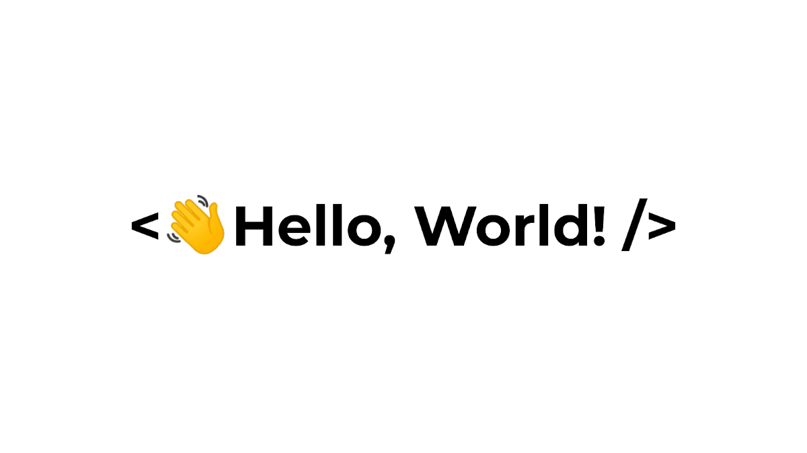
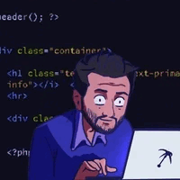
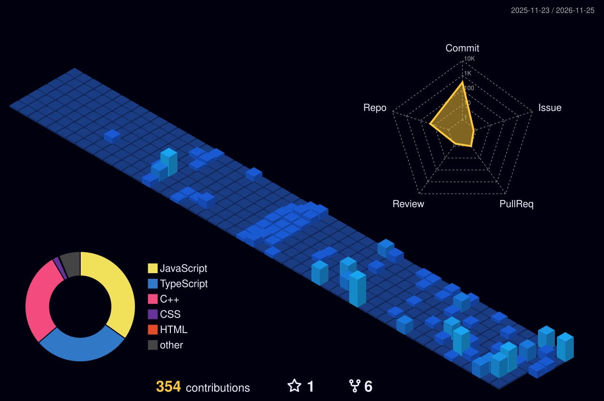

<!-- 

  

 -->

  

<!-- <h1 align="center">Hi, I'm Sameer Ahmad Khan</h1> -->

  

  
  
  
  

---

### 💫 About Me:

- 🏫 **Education:** Second-year B.Tech student specializing in Computer Science and Engineering.
- 💻 **Technical Focus:** Actively mastering Data Structures & Algorithms (DSA) alongside core backend and full-stack architecture.
- 🛠️ **Stack Competency:** Developing robust applications using the MERN stack, TypeScript, and multi-language logic implementation.
- 🎯 **Professional Goal:** Aiming to engineer scalable, high-performance software solutions and contribute to impactful technology frameworks.

  
  &nbsp;&nbsp;&nbsp;
  

---

### 🌐 Find Me On:

  &nbsp;&nbsp;
  &nbsp;&nbsp;
  &nbsp;&nbsp;
  &nbsp;&nbsp;
  

---

### 💻 Tech Stack:

  

#### 🚀 Languages

  

#### 🌐 Frontend Frameworks & UI

  

#### ⚙️ Backend, APIs & Databases

  

#### 🛠️ DevOps & Version Control

  

#### 🤖 Data Science & Machine Learning

  &nbsp;
  &nbsp;
  &nbsp;
  

---

### 📊 Core Focus Areas:

**Competitive Programming & DSA** 

**Full-Stack Web Development** 

**Machine Learning** 

---

### 📈 GitHub Analytics

  
  

---

### ✍️ Dev Quote

  

---

### 🏙️ 3D Contribution City

  

---

### 🐍 My Contribution Snake

